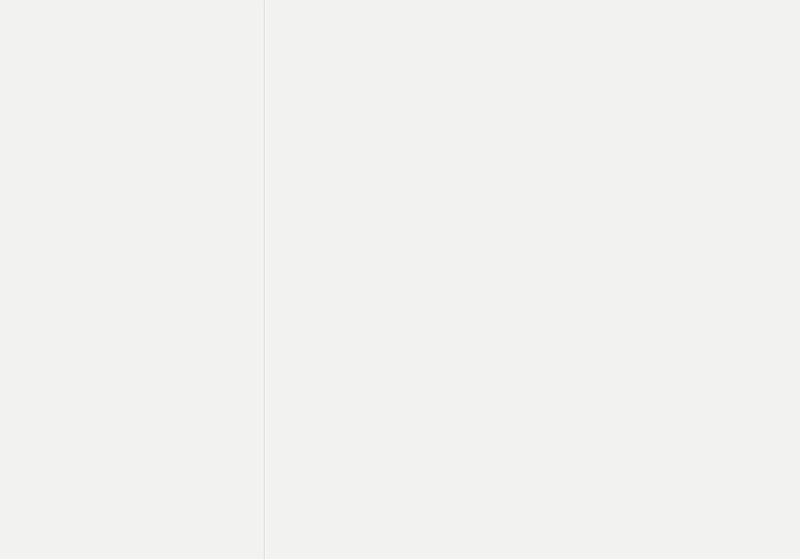
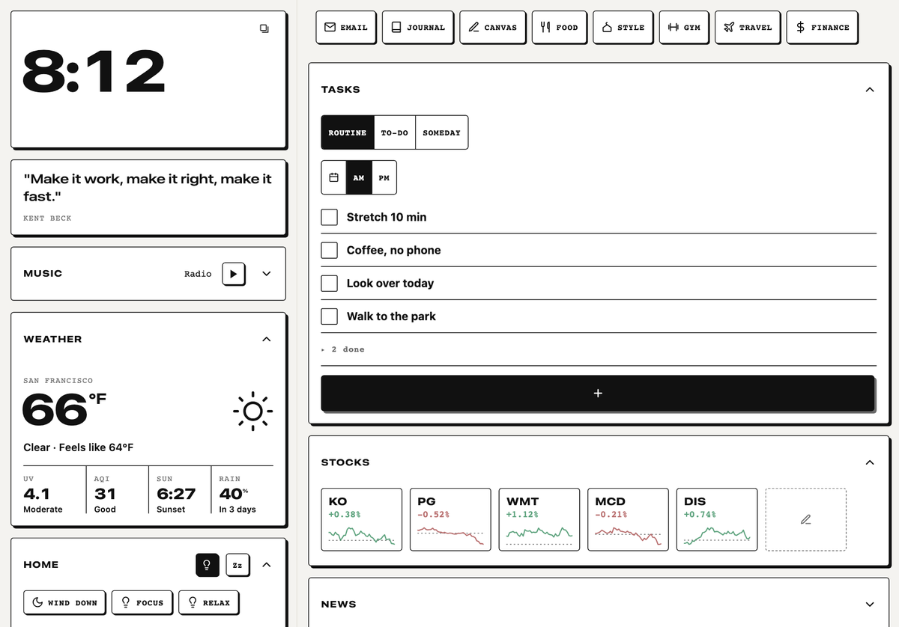
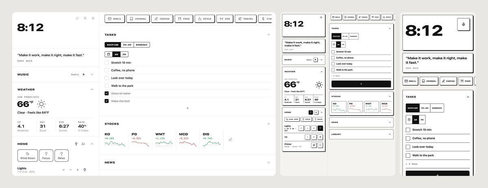
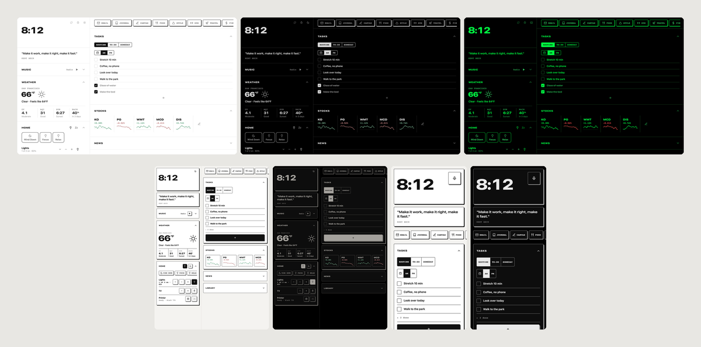
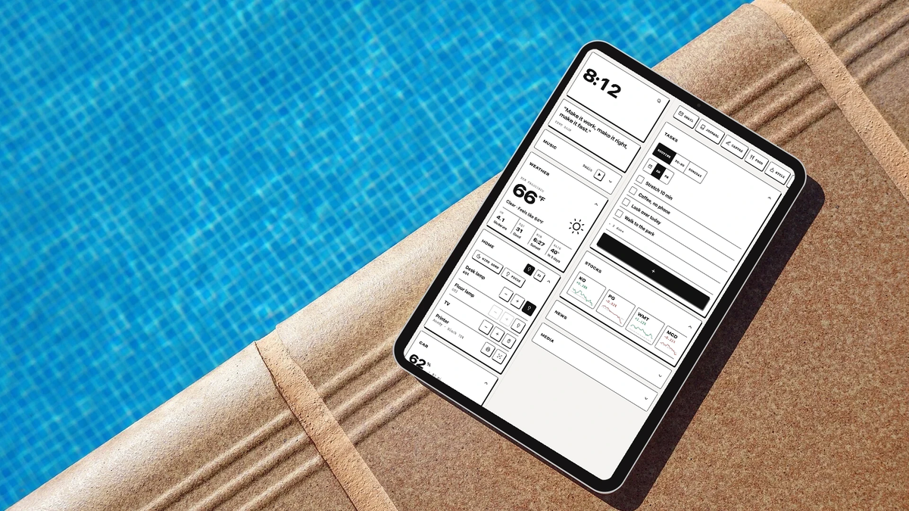
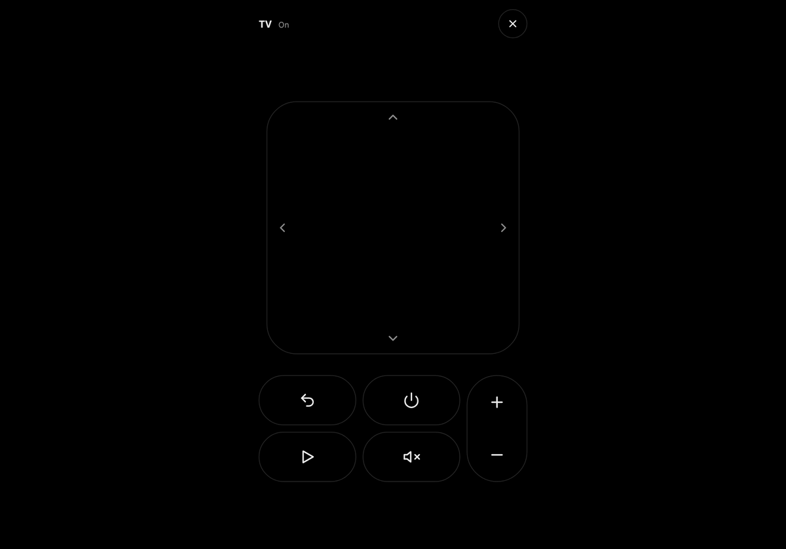

# LifeOS

A dashboard for my whole day: tasks, routines, weather, music and the lights at home, on one screen.

## What it is

I designed and built a dashboard for myself so I can check my day at a glance instead of opening a handful of apps. It runs on my laptop, iPad and phone. With everything in one place, I can spot patterns in my habits.

## What I designed

The Print theme up close, with routines, weather, music and the Home controls on one screen.

One dashboard, laid out for my laptop, iPad and phone.

The same layout in a few of its day and dark themes.

My iPad by the pool, in the Print theme.

The TV remote lives in the dashboard too, next to the Home controls.

## How it's built

A Flask server on a Mac mini at home, and one HTML page that installs on my phone and iPad like an app.

## Read more

The full case study: [raysums.com/lifeos-case-study.html](https://www.raysums.com/lifeos-case-study.html)

## The code

The code is private, because LifeOS runs on my own data. This repo shows the design only.

Designed and built by Raymond Su · [raysums.com](https://www.raysums.com)
